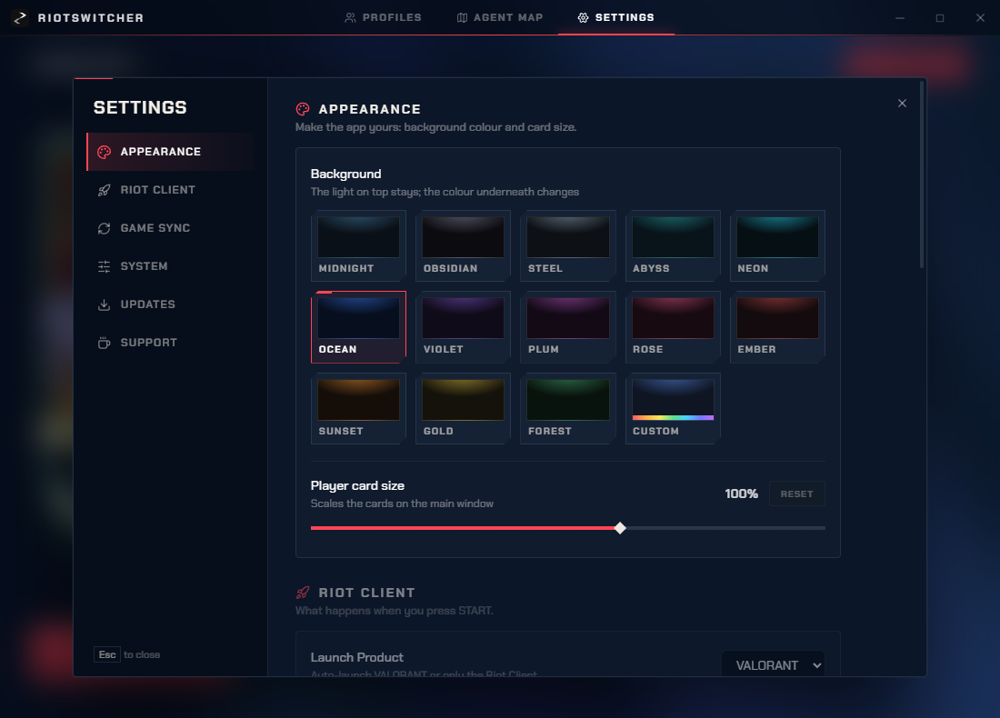

# RiotSwitcher

[](https://github.com/yassine808/assist/releases/latest)
[](https://github.com/yassine808/assist/releases)
[](https://github.com/yassine808/assist/actions/workflows/ci.yml)
[](https://github.com/yassine808/assist/issues)
[](https://github.com/yassine808/assist/stargazers)
[](LICENSE)
[](https://github.com/yassine808/assist/releases/latest)

**One click, another account.** RiotSwitcher keeps a copy of each Riot login
and swaps it in before the Riot Client starts, so you never type a password
or sit through a fresh login again.


**[Download the latest version »](https://github.com/yassine808/assist/releases/latest)** ·
[All releases](https://github.com/yassine808/assist/releases) ·
[Report a bug](https://github.com/yassine808/assist/issues/new/choose) ·
[Technical docs](docs/ARCHITECTURE.md)

<details>
<summary><b>Contents</b></summary>

- [How it works](#how-it-works)
- [Download](#download)
- [What it does](#what-it-does)
- [Screenshots](#screenshots)
- [Make it yours](#make-it-yours)
- [Signing out](#signing-out)
- [Updating](#updating)
- [Player cards](#player-cards)
- [Tech stack](#tech-stack)
- [Development](#development)
- [Where data lives](#where-data-lives)
- [FAQ](#faq)
- [Links](#links)
- [License](#license)

</details>

---

## How it works

1. **Add an account once.** RiotSwitcher saves the login the Riot Client just
   wrote to disk (or opens the client and waits for you to log in).
2. **Click a profile card.** It closes the Riot Client, backs up the current
   login, writes the target login in its place, and relaunches the client.
3. **That's it.** The client opens already signed in to the account you picked.

Nothing is sent to Riot, no game files are touched, and no passwords are
stored. Only the Riot Client's own session files are copied, atomically, on
your own machine.

| You want to… | Do this |
|---|---|
| Switch account | Click the play button on a profile card |
| Add a new account | **Add Account** → log in once in the window that opens |
| Rename / delete a profile | Right-click its card |
| Pick a player card | Click the card art on a profile |
| See ranks and stats | They refresh automatically every 2 minutes |
| Sign out of the Riot Client | Click the door icon next to **RUNNING** |
| Change the look | **Settings → Appearance** |
| Launch VALORANT on start | **Settings → Riot Client → Launch Product** |
| Share in-game settings | **Settings → Game Sync** |
| Launch a profile from the desktop | **Customize → Desktop shortcut** |

---

## Download

Grab the latest installer from the
**[releases page](https://github.com/yassine808/assist/releases/latest)**.

- **`RiotSwitcher-Setup-x.y.z.exe`** — normal install (recommended)
- **`RiotSwitcher-x.y.z-portable.exe`** — run without installing

Windows 10/11, x64. The builds are not code-signed, so SmartScreen may ask for
confirmation the first time you run the installer.

---

## What it does

- **Instant switching** — session files are swapped on disk; no re-login.
- **Profile cards** — VALORANT-style cards with player card art, rank, RR and
  recent form. Drag them to reorder; the order is saved.
- **Live stats** — rank, peak rank, agent picks and win rate per account.
- **Agent map breakdown** — per-map and per-agent performance in the **Agent
  Map** tab.
- **Game settings sync** — one master snapshot of your League settings, shared
  with every profile.
- **Desktop shortcuts** — one shortcut per profile that launches it directly.
- **Encrypted sessions** — saved Riot Client sessions are sealed with Windows
  DPAPI, so only your Windows account can read them.

---

## Screenshots

| Profiles | Settings |
|---|---|
|  |  |

---

## Make it yours

**Appearance** — pick one of 13 background themes or any custom colour, and
scale the profile cards from 70% to 120%.

**Riot Client** — choose what **START** opens: VALORANT (default) or just the
Riot Client.

**Game Sync** — turn on setting sharing, then name the profile whose settings
are the master copy.

**System** — interface sounds, plus close and minimise to tray.

**Support** — RiotSwitcher is free and open source; GitHub Sponsors is there if
you want to chip in.

---

## Signing out

Each running profile shows a door icon next to **RUNNING**. It closes the Riot
Client, deletes the live login files and keeps the saved profile — so the next
**START** signs in again.

If VALORANT is running, a switch or sign-out asks first. Confirming closes
VALORANT and carries on; cancelling leaves everything exactly as it was.

---

## Updating

RiotSwitcher updates itself. On every start it asks GitHub for the newest
release and compares it with the version you are running. If a newer one
exists it downloads it in the background and applies it the next time you
quit — the app then reopens on the new version. While it stays open it checks
again every four hours. There is also a **Check for updates** button in
Settings.

---

## Player cards

Player card art is downloaded **once**, into a small local database
(`playercards.db` next to the other app data), and served from disk after
that. There is no per-launch download and no delay when opening the picker.
The catalogue is re-checked at most **once a week** so newly released cards
show up; if that check fails you keep the cards you already have.

The **Customize** picker also carries 30 animated Agent Mastery cards that ship
with the app.

---

## Tech stack

| Layer | Technology |
|---|---|
| Desktop shell | Electron 44, electron-updater |
| UI | React 19, TypeScript, Tailwind CSS, lucide icons |
| Backend | Python 3.9, SQLite, PyInstaller |
| IPC | JSON lines over stdin/stdout, `contextBridge` for the renderer |
| Encryption | Windows DPAPI (`CryptProtectData`) |
| Stats | [HenrikDev API](https://henrikdev.xyz), valorant-api.com |

Three processes: Electron main ↔ Python backend over stdin/stdout ↔ React
renderer over `contextBridge`. See
[`docs/ARCHITECTURE.md`](docs/ARCHITECTURE.md) for the full picture.

---

## Development

Requirements: Node 22.22.2+, Python 3.9+, Windows.

```powershell
npm install
npm run dev          # Electron + React + the Python backend it spawns
```

```powershell
npm run typecheck        # TypeScript
npm run lint             # ESLint
npm run test             # Vitest
npm run test:py          # pytest
npm run check:api-leaks  # no key or .env can reach the bundle
npm run build            # production bundle
npm run dist             # installer + portable exe in release/
```

`npm run dev` starts Electron only; Electron spawns the Python backend itself.
Running `npm run dev:python` at the same time creates a second backend on the
same data directory and corrupts `profiles_data.json`.

Optional: put a HenrikDev key in `.env` for higher rate limits:

```
HENRIKDEV_API_KEY=your_key_here
```

Free key at [henrikdev.xyz](https://henrikdev.xyz).

### Project layout

```
src/
  main/        Electron main process (window, tray, updater, Python bridge)
  preload/     contextBridge API exposed to the renderer
  renderer/    React UI (views, components, hooks, styles)
  backend/     Python backend (flat modules, no package nesting)
tests/         pytest suites
docs/          architecture reference and screenshots
```

### Tests and CI

Every push to `main` and every pull request runs the full gate on GitHub
Actions: typecheck, ESLint, Prettier, Vitest, `npm audit`, the API-key leak
scanner, Ruff, `compileall`, pytest, and a production build with bundle checks.

---

## Where data lives

| What | Path |
|---|---|
| Profiles, config, player-card DB | `C:\ProgramData\RiotSwitcher` (dev: `.\data`) |
| Live Riot Client session | `%LOCALAPPDATA%\Riot Games\Riot Client` |

On first launch of a new version, data from the old `%APPDATA%\RiotSwitcher`
folder is moved into `C:\ProgramData\RiotSwitcher` once. The old copy is
removed as part of the move, so the saved session tokens exist in one place
only. Sessions are encrypted with DPAPI; the folder itself is restricted to
your Windows user.

The app reads and writes **Riot Client files only** — never VALORANT files,
never Vanguard, never game memory. The one exception is the quit dialog above:
if you confirm it, RiotSwitcher closes the two VALORANT processes so the switch
can happen. It never does that on its own.

---

## FAQ

**Does it store my password?**
No. It never sees a password. It copies the Riot Client's own session files and
seals them with DPAPI.

**Which games does it cover?**
Anything that signs in through the Riot Client. The stats and player cards are
VALORANT-specific; setting sync covers League of Legends.

**What happens if I delete a profile?**
Its saved session is deleted. The live Riot Client login is left alone.

**Why does it ask before closing VALORANT?**
Swapping session files while the game is running breaks the running match. The
app refuses the switch and offers to close the game first.

**The installer triggered SmartScreen.**
The builds are not code-signed. Choose *More info → Run anyway*.

---

## Links

| | |
|---|---|
| Latest version | <https://github.com/yassine808/assist/releases/latest> |
| All releases | <https://github.com/yassine808/assist/releases> |
| Deployments | <https://github.com/yassine808/assist/deployments> |
| CI runs | <https://github.com/yassine808/assist/actions> |
| Issues | <https://github.com/yassine808/assist/issues> |
| Sponsor | <https://github.com/sponsors/yassine808> |
| Architecture | [docs/ARCHITECTURE.md](docs/ARCHITECTURE.md) |

---

## License

GPL-3.0-or-later. See [LICENSE](LICENSE).
