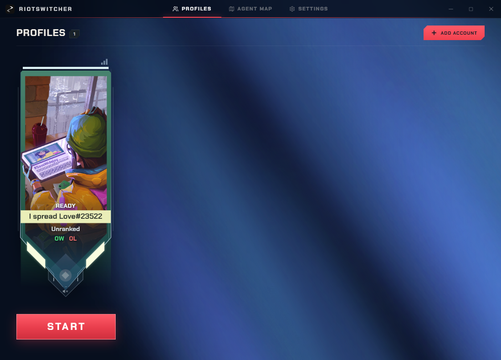

# RiotSwitcher

[](https://github.com/yassine808/assist/releases/latest)
[](LICENSE)
[](https://github.com/yassine808/assist/releases/latest)

**One click, another account.** RiotSwitcher keeps a copy of each Riot login
and swaps it in before the Riot Client starts, so you never type a password
or sit through a fresh login again.



---

## TL;DR — how it works

1. **Add an account once.** RiotSwitcher saves the login the Riot Client just
   wrote to disk (or opens the client and waits for you to log in).
2. **Click a profile card.** It closes the Riot Client, backs up the current
   login, writes the target login in its place, and relaunches the client.
3. **That's it.** The client opens already signed in to the account you picked.

Nothing is sent to Riot, no game files are touched, and no passwords are
stored. Only the Riot Client's own session files are copied, atomically, on
your own machine.

| You want to… | Do this |
|---|---|
| Switch account | Click the play button on a profile card |
| Add a new account | **Add Account** → log in once in the window that opens |
| Rename / delete a profile | Right-click its card |
| Pick a player card | Click the card art on a profile |
| See ranks and stats | They refresh automatically every 2 minutes |
| Back up everything | **Import / Export** → encrypted `.rsprofile` file |

---

## Download

Grab the latest installer from the
**[releases page](https://github.com/yassine808/assist/releases/latest)**.

- **`RiotSwitcher.Setup.x.y.z.exe`** — normal install (recommended)
- **`RiotSwitcher-x.y.z-portable.exe`** — run without installing

Windows 10/11, x64.

---

## What it does

- **Instant switching** — session files are swapped on disk; no re-login.
- **Profile cards** — VALORANT-style cards with player card art, rank, RR and
  recent form.
- **Live stats** — rank, peak rank, agent picks and win rate per account.
- **Agent map breakdown** — per-map and per-agent performance in its own window.
- **Appear Offline** — optional local proxy that hides your presence.
- **League settings sync** — keep hotkeys and video settings across accounts.
- **Encrypted import/export** — move every profile to another PC.

---

## Updating

RiotSwitcher updates itself. On every start it asks GitHub for the newest
release and compares it with the version you are running. If a newer one
exists it downloads it in the background and applies it the next time you
quit — the app then reopens on the new version. While it stays open it checks
again every four hours. There is also a **Check for updates** button in
Settings.

---

## Player cards

Player card art is downloaded **once**, into a small local database
(`playercards.db` next to the other app data), and served from disk after
that. There is no per-launch download and no delay when opening the picker.
The catalogue is re-checked at most **once a week** so newly released cards
show up; if that check fails you keep the cards you already have.

---

## Development

Requirements: Node 22+, Python 3.9+, Windows.

```powershell
npm install
npm run dev          # Electron + React + the Python backend it spawns
```

```powershell
npm run typecheck    # TypeScript
npm run lint         # ESLint
npm run test         # Vitest
npm run test:py      # pytest
npm run build        # production bundle
npm run dist         # installer + portable exe in release/
```

`npm run dev` starts Electron only; Electron spawns the Python backend itself.
Running `npm run dev:python` at the same time creates a second backend on the
same data directory and corrupts `profiles_data.json`.

Optional: put a HenrikDev key in `.env` for higher rate limits:

```
HENRIKDEV_API_KEY=your_key_here
```

Free key at [henrikdev.xyz](https://henrikdev.xyz).

### Where data lives

| What | Path |
|---|---|
| Profiles, config, player-card DB | `%APPDATA%\RiotSwitcher` (dev: `.\data`) |
| Live Riot Client session | `%LOCALAPPDATA%\Riot Games\Riot Client` |

The app reads and writes **Riot Client files only** — never VALORANT, never
Vanguard, never game memory.

---

## License

GPL-3.0-or-later. See [LICENSE](LICENSE).

Technical reference (architecture, IPC protocol, flows):
[docs/ARCHITECTURE.md](docs/ARCHITECTURE.md).
